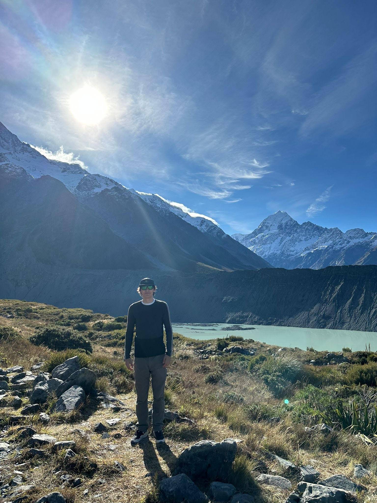
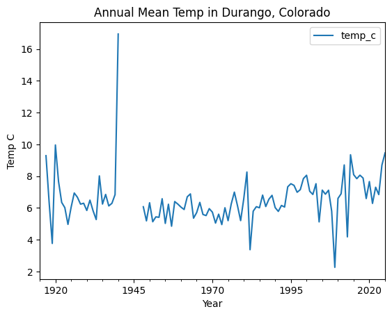
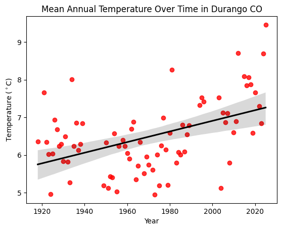

# Undergraduate Univerity of Colorado Boulder

  
  <figcaption style="font-style: italic; font-size: 0.9em; margin-top: 8px; color: #555;">
    Me at Mt. Cook during my study aboard in New Zealand. 
  </figcaption>

    
## Contact Information:

- KaiSkowlund@colorado.edu

- [LinkedIn](https://www.linkedin.com/in/kai-skowlund-0a5158358/)

- [GitHub](https://github.com/KaiSkowlund)

- [Instagram](https://www.instagram.com/kai.skowlund/)

## About Me!
I am a fourth-year Geography student at CU Boulder specializing in spatial analysis, remote sensing, and geospatial programming. My work focuses on turning complex geographic data into actionable insights through Python-based automation, machine learning, and modern GIS workflows. I am actively seeking internship and entry-level opportunities with federal agencies, environmental consulting firms, and organizations where spatial thinking drives real decisions.

I'm originally from Durango, Colorado and moved out to Boulder in 2022 to begin my Undergraduate program. I'm an avid outdoorsman, in my freetime you can find me enjoying some fly fishing, kayaking, climbing, or possibly hiking up the next 14er on the bucket list!

I'm excited to improve my python skills in GIS applications in this Earth Data Science course. I'm specifically interested in satellite imagery classification using learning algorithms, as well as creating maps related to resource management. Recently, I have become very interested in forestry and wildfire vulnerability approaches, so I'm hoping to pick up some skills to make me more efficient those type of projects.
Id like to find out how the skills I learn in this course will complement my other skills using GIS software and analyzing imagery. I'm looking to bridge the gap between using the manual tools in ArcGIS Pro and more efficient open source python tools, and the ArcPy module itself in ArcGIS Pro.  

Id like to answer questions about wildfire vulnerability in the Front Range. I'm very interested in mapping and predicting areas of high fuel concentration or optimal conditions for wildfire ignition,  in areas where structure has a high risk of being impacted. After the Marshal Fire in Dec. 2021, and seeing the costly impact on the Superior/Broomfield area, I have been very interested in mitigation and risk management efforts people can take into the future. 

## Map of CU Boulder
<figure style="text-align: center;">
  <embed 
    type="text/html" 
    src="img/boulder.html" 
    width="100%" 
    height="500px" 
    style="border: 1px solid #ddd; border-radius: 8px; box-shadow: 0 4px 6px rgba(0,0,0,0.1);"
  />
  <figcaption style="font-style: italic; font-size: 0.9em; margin-top: 8px; color: #555;">
    CU Boulder has been my home and place of study for the last 4 years. It is very meaningful to me and my work!
  </figcaption>
</figure>

## Project: Climate Change in Durango, Colorado

Since I grew up in Durango, I analyzed how temperatures in the area have changed over the past century. I used daily temperature records from NOAA's Global Historical Climatology Network for the **Fort Lewis** weather station (USC00053016), located about 11 miles west of Durango. I calculated each day's average temperature from its maximum and minimum, converted it to Celsius, and then averaged the daily values by year.

### Annual Mean Temperature

<figure style="text-align: center;">
  
  <figcaption style="font-style: italic; font-size: 0.9em; margin-top: 8px; color: #555;">
    Annual mean temperature (°C) at the Fort Lewis station, averaged from daily temperature records.
  </figcaption>
</figure>

Averaging by year removes the seasonal cycle and makes long-term changes easier to see. Temperatures still vary a lot from one year to the next, but the overall level has shifted upward over time. Gaps and sudden jumps in the line come from years when the station didn't report data, or reported only part of the year. To keep these incomplete years from skewing the results, I excluded them from the trend analysis below.

### Long-Term Warming Trend

<figure style="text-align: center;">
  
  <figcaption style="font-style: italic; font-size: 0.9em; margin-top: 8px; color: #555;">
    Annual mean temperature (°C) with an ordinary least squares (OLS) line of best fit.
  </figcaption>
</figure>

The line of best fit shows an average warming rate of about **0.0141 °C per year**, or roughly **1.41 °C (2.5 °F) per century**. Temperatures in the Durango area have clearly risen over the period of record. This closely matches statewide trends: Colorado has warmed about 2.5 °F since the early 1900s. (Frankson et al., 2022).

Warmer temperatures matter a lot for southwest Colorado. They mean less snowpack, earlier runoff in the Animas River, and drier conditions that raise wildfire risk. The topography and vegetation conditions in southwest Colorado are excellent wildfire fuel. Less moisture in the areas and higher temperatures have led to increased risk in fire frequency and severity.  

**Data source:** NOAA National Centers for Environmental Information, Global Historical Climatology Network – Daily, station USC00053016 (Fort Lewis, CO).

**Reference:** Frankson, R., Kunkel, K. E., Stevens, L. E., Easterling, D. R., Umphlett, N. A., Stiles, C. J., Schumacher, R., & Goble, P. E. (2022). *Colorado state climate summary 2022* (NOAA Technical Report NESDIS 150-CO). NOAA/NESDIS. [https://statesummaries.ncics.org/chapter/co/](https://statesummaries.ncics.org/chapter/co/)

## Project: Tracking Broad-tailed Hummingbird Migration Across the West

The Broad-tailed Hummingbird (*Selasphorus platycercus*) is the hummingbird most Coloradans know by sound. Males make a metallic trill with their wings that echoes through mountain meadows all summer. These birds weigh about as much as a nickel, yet they migrate each year between wintering grounds in the highlands of Mexico and Guatemala and breeding grounds in the mountains of the interior West, including Colorado and Wyoming (Olson, 2002). In spring they move north in steps: they reach southern Arizona in late February to early March, Colorado by late April to early May, and the northern edge of their range in Idaho by mid-May. By August they are heading back to Mexico (Olson, 2002).

I chose this species because it connects directly to where I grew up and live. Its breeding habitat is the montane willow, aspen, and spruce-fir country of the Colorado Rockies. I wanted to see whether community-collected observations could reconstruct this migration on a map.

### Data and Methods

**Observation data.** I downloaded all 2023 Broad-tailed Hummingbird records with coordinates from the [Global Biodiversity Information Facility (GBIF)](https://www.gbif.org/). GBIF pools occurrence records from museum collections, research surveys, and community science platforms such as eBird and iNaturalist. I used a single recent, complete year so that each month appears exactly once on the map.

**Ecoregions as the unit of analysis.** Instead of plotting thousands of individual points, I grouped the observations by ecoregion, using the RESOLVE Ecoregions 2017 dataset of 846 terrestrial ecoregions worldwide (Dinerstein et al., 2017). Ecoregions are defined by shared climate, vegetation, and wildlife communities. That makes them a natural unit for a migrating animal: the habitat a hummingbird depends on at a given time of year should be fairly consistent within one ecoregion, which isn't true of a state or country boundary.

**Spatial join.** I used a spatial join in GeoPandas to find the ecoregion that contains each observation, then counted the observations in each ecoregion for each month. To reduce misidentifications, I removed any ecoregion–month combination with only one record.

**Normalizing for sampling effort.** Raw counts mostly show where people are, not where birds are. GBIF data is strongly biased toward populated, accessible, well-studied places (Beck et al., 2014), and birders are also more active in some seasons than others. To correct for this, I divided each ecoregion–month count by that ecoregion's average monthly count, then by that month's average count across all ecoregions. The result is a *relative* measure. It shows when a region has more hummingbird observations than usual for that place and that time of year, which is what tracks the birds' movement.

### Hummingbirds Follow the Mountains North in Spring and Retreat to Mexico by Fall

<figure style="text-align: center;">
  <embed
    type="text/html"
    src="/img/broad_tailed_hummingbird_migration.html"
    frame_width=550
    frame_height=550
    style="border: 1px solid #ddd; border-radius: 8px; box-shadow: 0 4px 6px rgba(0,0,0,0.1);"
  />
  <figcaption style="font-style: italic; font-size: 0.9em; margin-top: 8px; color: #555;">
    Relative occurrence of Broad-tailed Hummingbirds by ecoregion in 2023, normalized for sampling effort by month and ecoregion. Use the slider to move through the year; brighter colors mean more observations than usual for that place and month. Data: GBIF.
  </figcaption>
</figure>

Moving the slider through the year shows the migration clearly. <!-- CHECK each claim below against your map -->

**Winter (December–February):** Observations are concentrated in the pine-oak and fir forests of the Mexican highlands, matching the known wintering range. <!-- CHECK: any winter records in southern Arizona? Year-round feeders in the Southwest have led some birds to stay (Olson, 2002). -->

**Spring (March–May):** The signal moves north in stages. Arizona and New Mexico ecoregions light up first, and Colorado and Utah follow by late April and May. This matches the stepwise arrival described in the literature. <!-- CHECK -->

**Summer (June–August):** Observations peak in the montane forests of the Southern Rockies, the Wasatch and Uinta Mountains, and the Great Basin. This is the breeding range, where females nest in willows, aspen, and conifers along mountain streams. <!-- CHECK -->

**Fall (September–November):** The signal drops out of the northern ecoregions and moves back toward Mexico. <!-- CHECK: is it already fading in August? Olson (2002) reports birds reaching Mexico by August. -->

### Why It Matters: A Race Against the Wildflowers

Timing is everything for a hummingbird. Broad-tailed Hummingbirds arrive in the Rockies just as the first nectar flowers, such as glacier lilies, begin to bloom. A 2012 study, which included long-term records from the Rocky Mountain Biological Laboratory near Crested Butte, Colorado, found that early-season flowers at the northern breeding sites now bloom earlier than they used to, while hummingbird arrival has not kept pace (McKinney et al., 2012). Glacier lilies bloom about 17 days earlier than in the 1970s, and the gap between the first hummingbird and the first flower shrank by 13 days over four decades. In some years the lilies had already bloomed before the first hummingbird arrived. The authors projected that if these trends continue, the birds could miss the first flowers entirely within about two decades (McKinney et al., 2012; ScienceDaily, 2012).

This is the phenological mismatch I looked at in the Veery work. A map like this one, repeated over several years, could show whether the timing of the spring push into Colorado is shifting.

### Limitations

- **Sampling bias remains.** Normalizing helps, but community science still underrepresents remote areas. Mexico's highland wintering grounds likely have far fewer observers than the Colorado Front Range or southern Arizona, so the winter signal is probably weaker than the true number of birds.
- **One year of data.** 2023 is a single snapshot. Weather in any one year can shift migration timing, so detecting a trend would need multiple years.
- **Ecoregions are coarse.** Broad-tailed Hummingbirds also move up and down in elevation within a single ecoregion, and that movement can't be seen at this scale.
- **Relative, not absolute.** The normalized values show *when* a region is unusually active, not how many birds are actually there.

**Data sources:** GBIF.org (2023) GBIF Occurrence Download, *Selasphorus platycercus* [add your download DOI here]; RESOLVE Ecoregions 2017.

**Code:** [GitHub repository](https://github.com/KaiSkowlund/[your-repo-name])

**References:**

Beck, J., Böller, M., Erhardt, A., & Schwanghart, W. (2014). Spatial bias in the GBIF database and its effect on modeling species' geographic distributions. *Ecological Informatics*, 19, 10–15. [https://doi.org/10.1016/j.ecoinf.2013.11.002](https://doi.org/10.1016/j.ecoinf.2013.11.002)

Dinerstein, E., Olson, D., Joshi, A., Vynne, C., Burgess, N. D., et al. (2017). An ecoregion-based approach to protecting half the terrestrial realm. *BioScience*, 67(6), 534–545. [https://doi.org/10.1093/biosci/bix014](https://doi.org/10.1093/biosci/bix014)

McKinney, A. M., CaraDonna, P. J., Inouye, D. W., Barr, B., Bertelsen, C. D., & Waser, N. M. (2012). Asynchronous changes in phenology of migrating Broad-tailed Hummingbirds and their early-season nectar resources. *Ecology*, 93(9), 1987–1993. [https://doi.org/10.1890/12-0255.1](https://doi.org/10.1890/12-0255.1)

Olson, E. (2002). *Selasphorus platycercus* (broad-tailed hummingbird). Animal Diversity Web. [https://animaldiversity.org/accounts/Selasphorus_platycercus/](https://animaldiversity.org/accounts/Selasphorus_platycercus/)

ScienceDaily. (2012, June 1). Hummingbirds' 22-million-year-old history of remarkable change is far from complete. [https://www.sciencedaily.com/releases/2012/06/120601231752.htm](https://www.sciencedaily.com/releases/2012/06/120601231752.htm)

  

